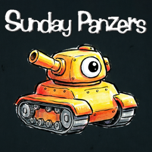
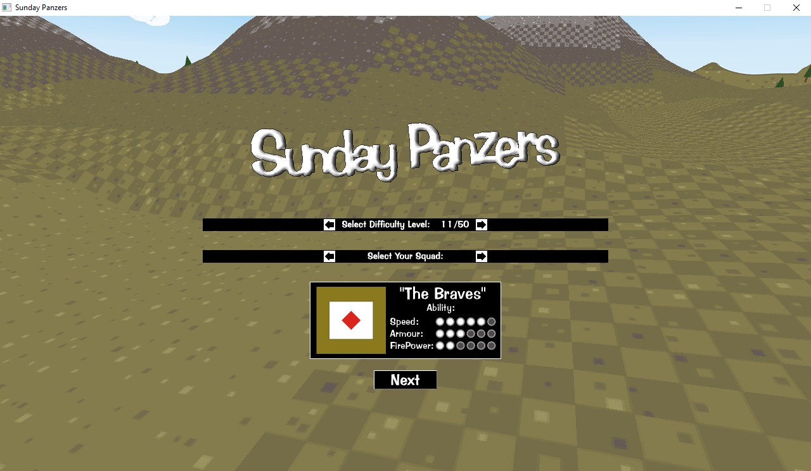
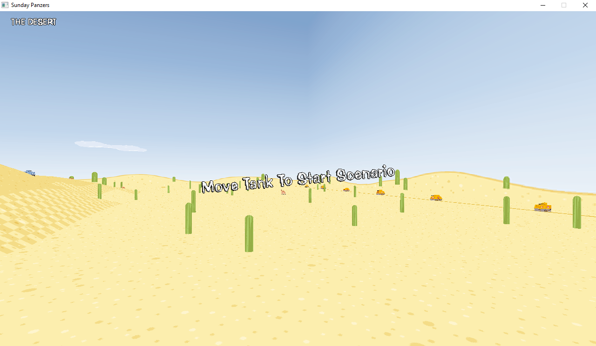
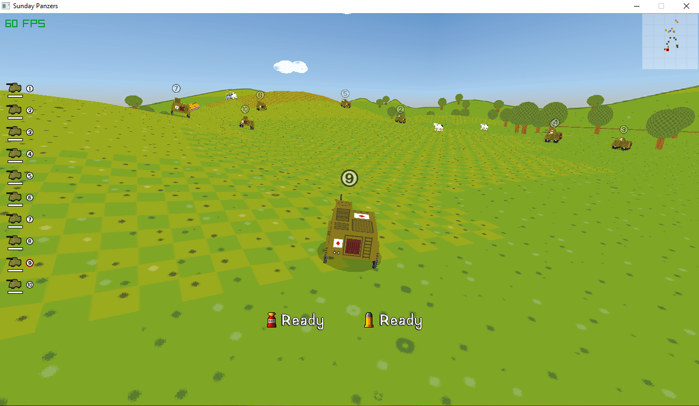

# Sunday Panzers


**Sunday Panzers** is a 3D tank combat game: The second of "Sunday" series, this time you've to smash tanks in a funny and chaotic battle. 50 levels, 8 different tanks, 10 squads to unlock and 6 scenarios, plus powerups and more. Control a max of 12 tanks versus 28 enemy tanks and 5 guest tanks! Have fun! The project is file by file and with source code.

This repository contains a modern open-source reimplementation of the original
freeware game *Sunday Panzers* (2004) by **Bertone Ermes (Ermesdesign)**,
originally written in DarkBASIC Pro.

### ☕ Like this port? You can support the author!

[](https://boosty.to/worthis)
[](https://hipolink.net/worthis)

## Screenshots

| | | |
|:---:|:---:|:---:|
|  |  |  |

## Original game

|                     |                                                       |
|---------------------|-------------------------------------------------------|
| Author              | Bertone Ermes (Ermesdesign)                           |
| Year                | 2004                                                  |
| Original language   | DarkBASIC Pro                                         |
| Original source     | `sunday_panzers.dba`, Version 1.2 08-12-2004          |
| Website             | http://xoomer.virgilio.it/ermesjr (not available)     |
| E-mail              | ermesjr@libero.it (not available)                     |

The original game was released as freeware. All credits for the game design,
artwork and sounds belong to the original author.

## This reimplementation

|                     |                                                       |
|---------------------|-------------------------------------------------------|
| Language            | C++17                                                 |
| Framework           | [raylib](https://www.raylib.com/)                     |
| Platforms           | Windows (x86_64), Nintendo Switch (homebrew)          |
| Build system        | GNU Make                                              |

### Technologies & tools

- [raylib](https://www.raylib.com/) — simple and easy-to-use library for game development (zlib license)
- [raylib-nx](https://github.com/luizpestana/raylib-nx) — Nintendo Switch port of the raylib by Luiz Pestana (zlib license)
- [devkitPro](https://devkitpro.org/) (devkitA64 + libnx) — Nintendo Switch homebrew toolchain
- [MinGW-w64](https://www.mingw-w64.org/) — Windows cross-compilation
- [nlohmann/json](https://github.com/nlohmann/json) — JSON for settings, game data and saves (MIT)
- [Docker / devcontainer](https://www.docker.com/) — reproducible build environment
- [GNU Make](https://www.gnu.org) — build automation

## Features

- 50 campaign levels with scaling AI difficulty
- 10 squads and 8 tank types; squad constructor with credit-based buying
- Real-time commander switching between your tanks
- 6 biomes: grass country, mountains, desert, frozen country, tundra, the Moon
- Power-ups, turbo mode, destructible trees
- Keyboard & mouse, gamepad and touch-screen controls
- Progress saving and a final ending after completing level 50

## Controls

The port uses its own control scheme (it differs from the original DBP game).
All bindings can be changed in `settings.json` — see [Configuration](#configuration).

> **Note:** if a gamepad is connected, keyboard and mouse are disabled entirely
> (including `F1`–`F12` and menu mouse clicks). Disconnect the pad to use them.

### Battle

| Action | Keyboard | Mouse | Gamepad (Switch / Xbox) |
|---|---|---|---|
| Move forward / back | `W` / `S` or `↑` / `↓` | — | left stick / D-pad |
| Turn left / right | `A` / `D` or `←` / `→` | — | left stick / D-pad |
| Fire | `Space` | left button | `A` / `B` |
| Turbo | `Left Ctrl`, `Right Ctrl` | right button | `B` / `A` |
| Rear view (hold) | `Left Alt`, `Right Alt` | — | `X` / `Y` |
| Next / previous tank | `E` / `Q` | — | `R` / `L` (`RB` / `LB`) |
| Select tank 1–12 directly | `F1`…`F12` (no gamepad connected) | — | — |
| Show/hide enemy tank IDs | `T` | — | `Y` / `X` |
| Leave battle, back to menu | `Esc` | — | `−` / `View` (Select) |
| Continue after the battle is over | `Enter` | — | `+` / `Menu` (Start) |
| Skip the result cinematic | `Enter`, `Space` | left button | `+`, `A` / `Menu`, `B` |

Switching tanks flies the camera to the selected tank; control is handed over
when the flight ends. Only living tanks of your squad can be selected.

### Menu — level & squad

| Action | Keyboard | Mouse | Gamepad (Switch / Xbox) |
|---|---|---|---|
| Level − / + | `←` / `→`, `A` / `D` | click the arrows | D-pad ←/→, `ZL`/`ZR` (`LT`/`RT`) |
| Squad − / + | `↑` / `↓`, `W` / `S` | click the arrows | D-pad ↑/↓, `L`/`R` (`LB`/`RB`) |
| Next | `Enter`, `Space` | click **Next** | `A` / `B`, `+` / `Menu` |
| Quit game | `Esc` | — | `−` / `View` |

### Menu — squad shop

| Action | Keyboard | Mouse | Gamepad (Switch / Xbox) |
|---|---|---|---|
| Slot − / + (1–12) | `←` / `→`, `A` / `D` | arrows, or click a slot in the row | D-pad ←/→, `ZL`/`ZR` |
| Tank type − / + (1–8) | `↑` / `↓`, `W` / `S` | click the arrows | D-pad ↑/↓, `L`/`R` |
| Buy tank | `Space` | click **Buy** or the tank preview | `A` / `B` |
| Sell tank | `Backspace` | click **Sell** | `B` / `A` |
| Make commander | `X` | click **Make commander** | `X` / `Y` |
| AI skill +1 (2 credits) | `Y` | click the right AI arrow | `Y` / `X` |
| AI skill −1 | — | click the left AI arrow | — |
| Back (clears the squad) | `Esc` | click **Back** | `−` / `View` |
| Start battle (needs ≥1 tank) | `Enter` | click **Battle** | `+` / `Menu` |

> `Enter` is bound to both *Buy* and *Battle*: use **`Space` to buy** and
> **`Enter` to start the battle**. Raising AI above the level maximum resets it
> to the minimum and refunds the credits.

### Intros & touch

* Logo / title screen: `Enter`, `Space`, left mouse button, `A`/`B` or `+`/`Menu`.
* Pre-battle fly-through: any movement input, `Enter`/`Space`, `A`/`+`, or a tap.
* Touch (Switch): a tap works as a click in menus and confirms intro/result
  screens; driving in battle uses the stick or D-pad.

## Configuration

On the first run the game creates `settings.json` in the working directory
(next to the executable; on Switch — in the folder with the `.nro`).
`save.json` (campaign progress) and `game_log.txt` are written to the same place.

The HUD and menus are drawn at the original 640×480 size, centred in the window;
a larger window adds borders around the interface, it does not scale the UI.
Game physics runs at a fixed 100 Hz step, so `targetFPS` affects smoothness and
CPU/GPU load only, not game speed.

### display

| Key | Default | Description |
|---|---|---|
| `width` | `1280` | window width, clamped to ≥ 640 |
| `height` | `720` | window height, clamped to ≥ 480 |
| `fullscreen` | `false` | fullscreen mode |
| `vsync` | `false` | vertical sync |
| `targetFPS` | `60` | render FPS limit |

### gameplay

| Key | Default | Description |
|---|---|---|
| `showDebug` | `true` | FPS counter in the top-left corner during battle |
| `showEnemyIDs` | `false` | enemy tank ID letters (same as the `T` toggle, saved on exit from battle) |
| `musicEnabled` | `true` | reserved, currently not used by the game |
| `sound3DEnabled` | `true` | stereo panning of sounds; `false` = flat mono mix like the original |

### input

Every action is an object with up to three arrays: `keyboard`, `mouse`, `gamepad`.
Several keys/buttons per action are allowed; an action with an empty/missing
array is simply unbound. Names are case-sensitive and must match the tables below —
an unknown name is silently ignored.

```json
"fire": {
    "keyboard": ["SPACE"],
    "mouse": ["LEFT_BUTTON"],
    "gamepad": ["B"]
}
```

## Building

### Windows

```bash
make win
# run: ./build/win/sunday_panzers.exe
```

### Nintendo Switch

```bash
make switch
# copy contents of build/switch/ to sdmc:/switch/SundayPanzers/
```

### Linux Handhelds (not finished)

```bash
# build docker image
docker build --platform linux/arm64 -t sundaypanzers-handheld -f Dockerfile.handheld .

# build and pack
docker run --platform linux/arm64 --rm -v ${pwd}:/workspace -w /workspace sundaypanzers-handheld make -f makefile.handheld build pack

# build portmaster pack
docker run --platform linux/arm64 --rm -v ${pwd}:/workspace -w /workspace sundaypanzers-handheld make -f makefile.handheld portmaster

# build all
docker run --platform linux/arm64 --rm -v ${pwd}:/workspace -w /workspace sundaypanzers-handheld make -f makefile.handheld

# clean
docker run --platform linux/arm64 --rm -v ${pwd}:/workspace -w /workspace sundaypanzers-handheld make -f makefile.handheld clean

# copy contents of build/handheld/ to your SDCARD, maintaining the folder structure of your CFW
```

## License

- **Port source code** (`source/`) is licensed under the [MIT License](LICENSE).
- **Original game** (concept, design, graphics, sounds) © 2004 Bertone Ermes
  (Ermesdesign), originally released as freeware. 
- **This project** is a fan-made reimplementation made for educational purposes; all rights to the original intellectual property remain with the author.

## Thanks

- Bertone Ermes (Ermesdesign) for original game of my childhood.
- [raysan5](https://www.raylib.com/) for raylib - simple and easy-to-use library for game development.
- [Luiz Pestana](https://github.com/luizpestana/raylib-nx) for Nintendo Switch port of the raylib.